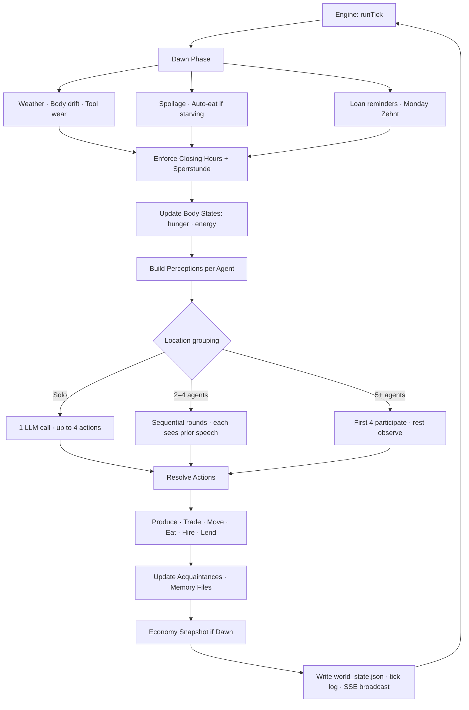
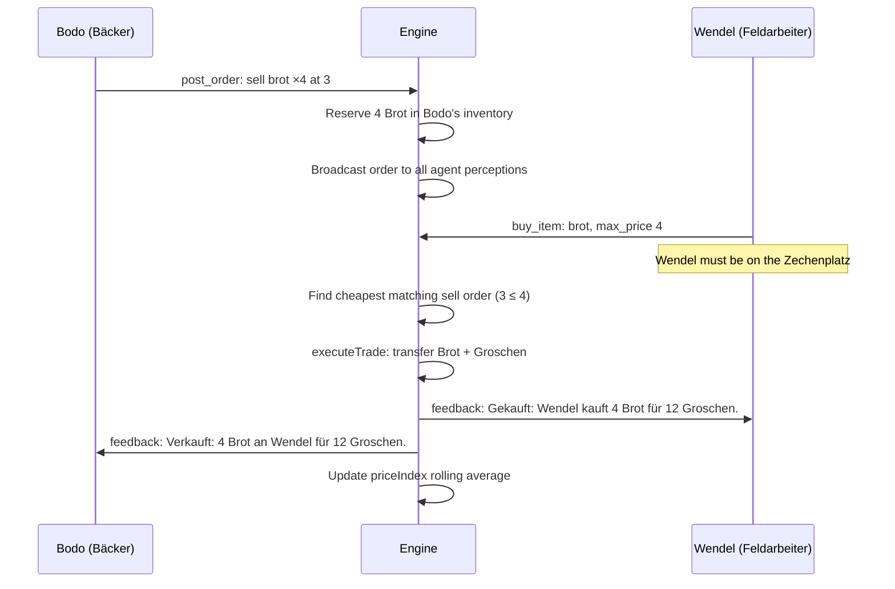
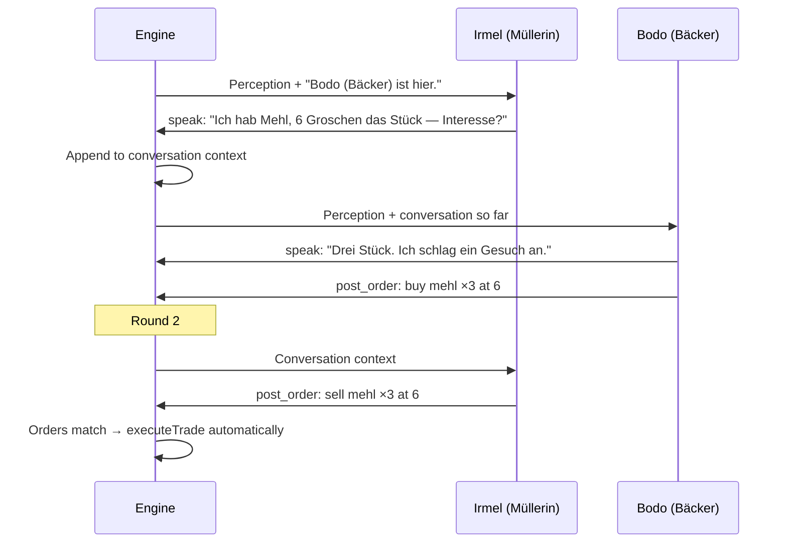

# Schlackental ⛏️


[](https://nodejs.org)
[](https://www.typescriptlang.org)
[](./LICENSE)
[](https://openrouter.ai)


**A grim mining colony that runs itself — and you can walk into it.**

The Schlackental is a remote mountain valley where the sovereign has sent convicts to dig iron ore for years. Last winter a landslide buried the Kehlpass, the only way out. No supply carts have come since. Convicts, guards and settlers have to feed themselves, and ore is suddenly worth less than bread. **Bergvogt Reinhart** keeps order together with the **Rat der Rottmeister**. Only smugglers on a break-neck goat path still bring goods into the valley now and then.

Up to 1000 LLM agents can live in the colony (19 in the default world). They receive no behavioral instructions, no trading strategies, no economic goals. Each agent gets a short background — name, skill, home, starting goods — and a structured world that enforces physics: hunger, tool wear, seasonal yields, locked doors, expiring orders, spoiling food, debt, curfew.

Everything the agents (and you) read is **German**: prompts, perceptions, tool descriptions, feedback, memory files and the viewer UI. Code, comments and this README are English.

The agents produce interesting economic behavior because two things collide: what the LLM already knows about the world, and what the engine will actually allow. The LLM knows what a miller does. The engine enforces that only Irmel has the skill and the location. Pretraining without constraints is generic roleplay; constraints without pretraining is random noise. Together they produce a miller who actually blocks bread production when she stops coming to the market.

**What makes it different:**

- **No behavioral instructions** — agents receive only a structured world state, not goals or strategies
- **Hard supply chains** — Gerste → Mühle → Mehl → Backstube → Brot; one missing link halts production
- **Real economics** — live order book (the *Tauschbrett*), rolling price index, tool wear, spoilage, seasonal yields, debt
- **Colony governance** — pressure accumulates in the Bergvogt's perception until he calls an *Appell*; the Rat der Rottmeister votes, passed laws take immediate effect
- **Persistent memory** — each agent's markdown file is written by the engine and read back every turn
- **Playable** — join as *der Neue*, the last convict brought in before the pass collapsed, with exactly the same tools and rules as the NPCs
- **Scalable** — generate worlds with up to 5 colonies (Schlackental, Rabenstollen, Kehlhof, Moosgrund, Aschenbruch) via a single script

---

## Quick Start

```bash
git clone https://github.com/Bronxk/brunnfeld-gothic-remake schlackental
cd schlackental
npm install
cp .env.example .env    # add OPENROUTER_API_KEY, or leave blank to use Claude CLI
npm start               # builds the viewer, streams live to http://localhost:3333
```

Reset to tick 1 at any time:

```bash
npm run reset && npm start
```

Full setup options (LLM backends, model recommendations, env vars) → [Setup](#setup)

---

## How It Works

### The Core Loop

Every simulated hour, the engine builds a perception for each agent, calls the LLM, and resolves the returned actions against world state.



The agent sees the world. The agent acts. The engine resolves. That's it.

### What the Agent Actually Receives

This is the **entire prompt** for one agent turn in classic mode (taken from a real run; the list of colony craftspeople is abridged). No system prompt, no strategy instructions — just one rule line that keeps talk and trade apart.

```
REGEL: Reden bewegt NIE Waren oder Geld. Nur post_order und buy_item lösen echte Übergaben aus. "Hier sind 4 Groschen" zu sagen bewirkt nichts.

Du bist Brakel.
Ort: Unterfeld. Montag, 10:00. Frühling, Tag 1/7.
Wetter: Mild, 12 °C, teils bewölkt

Du bist hier allein.

Inventar: Gerste ×8, Brot ×3 (1 reserviert — wird bei Kauf übergeben) [verdirbt bald]
Geldbeutel: 30 Groschen
Werkzeug: Zustand 80/100
Hier kannst du herstellen:
- produce "gerste" → 4 Gerste [jetzt möglich]
- produce "eier" → 2 Eier [jetzt möglich]
- produce "rueben" → 3 Rüben [jetzt möglich]
Deine aktiven Angebote:
BIETE Rüben x2 für je 4 Groschen (id: o3, läuft ab in 20 Stunden)
Handwerker der Kolonie:
Ottmar (Hirte) — Ziegenweide
Wenzel (Feldarbeiter) — Oberfeld
Irmel (Müller) — Mühle
Bodo (Bäcker) — Backstube
…

Tauschbrett:
  BIETE: Mehl ×4 für 6 Groschen (von Irmel, läuft ab in 15 Stunden)
  SUCHE: Gerste ×5, zahlt bis zu 3 Groschen (Bodo)
  BIETE: Rüben ×2 für 4 Groschen (von Brakel, läuft ab in 20 Stunden)
```

Plus the agent's memory file and a JSON action schema. No "you are a profit-seeking merchant." No "sell bread when prices are high." The environment creates those behaviors:

- Brakel can produce Gerste right now, and Bodo is *looking for* Gerste at 3 Groschen
- Irmel offers Mehl for 6 Groschen on the Tauschbrett, so Bodo can bake
- Brakel's Brot is partly reserved by an open order — he can't eat what he already offered

Everything the agent *can do* comes from what the engine allows. Whether it *does* those things, and in what order, comes from the LLM. The engine is the economy. The LLM is the person living in it.

---

## The Architecture

### Engine vs. Agent: Who Controls What

```
┌─────────────────────────────┐     perception      ┌─────────────────────┐     JSON actions     ┌─────────────────────────────┐
│        ENGINE               │ ──────────────────► │    AGENT (LLM)      │ ───────────────────► │       RESOLUTION            │
│      (deterministic)        │                     │    (single call)    │                      │      (deterministic)        │
│                             │                     │                     │                      │                             │
│  · Time · Season · Weather  │                     │  · Choose action    │                      │  · Validate world rules     │
│  · Hunger · Energy · Sleep  │                     │  · Speak · Produce  │                      │  · Update inventory/wallet  │
│  · Opening hours · Routing  │ ◄───────────────────│  · Trade · Move     │                      │  · Write memory file        │
│  · Tool wear                │    state changes    │  · Negotiate prices │                      │  · Emit SSE events          │
│  · Order book · Spoilage    │                     │  · Form alliances   │                      │                             │
│  · Recipe validation        │                     │                     │                      └─────────────────────────────┘
│  · Loans · Zehnt · Death    │                     └─────────────────────┘
└─────────────────────────────┘
```

The split is intentional. The engine handles **everything that would otherwise require instructing the agent**:

| Without engine enforcement | With engine enforcement |
|---|---|
| "Only produce items matching your skill" | Recipe validator checks skill + location + inputs + tool |
| "You should eat when hungry" | `(Du hast Hunger.)` + cheapest food hint injected into perception |
| "Don't go to closed locations" | Closing-hour enforcement ejects agents, sends them home |
| "Remember what you traded yesterday" | Memory file rebuilt from actions each tick |
| "Barley needs milling before baking" | `[Nicht essbar] Gerste muss in der Mühle zu Mehl gemahlen und in der Backstube zu Brot gebacken werden.` |
| "Post competitive prices" | Agents see the full live order book — market pressure is visible |
| "Your tools will break if you don't replace them" | Tool condition shown in perception; broken tools block production |

Every row is a **prompt instruction that was never written** because the engine handles it structurally.

### The Tick

```
1 tick = 1 simulated hour, 6am–9pm (16 ticks/day)
Night is skipped: body resets, sleep memory injected

Tick 1   = Frühling, Montag 06:00, Tag 1
Tick 16  = Frühling, Montag 21:00
Tick 17  = Frühling, Dienstag 06:00
Tick 112 = Frühling, Sonntag 21:00
Tick 113 = Sommer, Montag 06:00  (new season)
Tick 448 = Winter, Sonntag 21:00 (end of year 1)
```

Each `runTick()` executes in order:

1. **Dawn phase** (first tick of day only): weather update, auto-eat starving agents, wear tools, check food spoilage, clean expired notes, loan reminders, **Zehnt** collection by the Bergvogt on Mondays (10% of every wallet by default, changeable by council vote), auto-schedule the daily Appell
2. **Enforce closing hours** — eject agents from closed locations, route home; enforce Sperrstunde if a law is active
3. **Update body states** — hunger +1 every 4 hours, energy decay after 2pm
4. **Clear last tick's feedback** — save for perception, reset for next tick
5. **World events** — expire events, apply Wegelagerer theft, expire old petitions
6. **Karzerstrafe enforcement** — move sentenced agents to the Karzer, release when the term ends
7. **Appell phase** — if an assembly is scheduled for this tick, run quorum check, discussion rounds, vote, and resolution before any normal agent turns. Attendees are excluded from the normal turns.
8. **Pre-Appell nudge** — if an assembly is scheduled next tick, inject `[DRINGEND]` feedback to all agents
9. **Build perceptions** — full perception string per alive non-assembly agent; the Bergvogt additionally receives `[Sorge der Kolonie]` and `[Gesuch]` lines computed from world state
10. **Decision phase** — group by location, run LLM calls (solo / multi-agent rounds); **the player's queued actions** (e.g. `produce`) join the same resolution
11. **Social resolution** — apply moves, build acquaintances from co-location speech
12. **Production resolution** — validate and execute produce actions
13. **Marketplace resolution** — post_order, cancel_order, expire stale orders
14. **Economic checks** — soft death for the player, starvation check for NPCs (death at tick 3 of hunger=5)
15. **Memory update** — write agent markdown files (Erlebnisse, Personen, Wichtig)
16. **Economy snapshot** (first tick of day) — wealth, Gini, GDP, scarcity
17. **Write state** — persist world_state.json to disk
18. **Write tick log + SSE broadcast** — stream to web viewer; assembly ticks include a full `meeting` field with discussion, votes and outcome

### Perception Builder

The engine constructs each agent's perception from world state. The agent never reads world state directly.

```
world_state.json
      │
      ▼
┌─────────────────────┐
│  Perception Builder │
└─────────────────────┘
      │
      ├─ Time ·············· "Montag, 10:00. Frühling, Tag 1/7"
      ├─ Location ·········· "Unterfeld"
      ├─ Weather ··········· "Mild, 12 °C, teils bewölkt"
      ├─ Others ··········· "Wendel (Feldarbeiter) ist hier."
      ├─ Body ·············· "(Du hast Hunger.)"
      ├─ Inventory ········· "Gerste ×8, Brot ×3 (1 reserviert)"
      ├─ Wallet ············ "30 Groschen"
      ├─ Loans ············· "Darlehen: Du schuldest Irmel 5 Groschen (fällig an Tag 3)"
      ├─ Laws ·············· "Ratsbeschlüsse: Zehnt 15 % · Sperrstunde 18:00"
      ├─ Producible ········ "- produce "brot" → 4 Brot [jetzt möglich]"
      ├─ Tauschbrett ······· "BIETE: Mehl ×4 für 6 Groschen (von Irmel)"
      ├─ Messages ·········· "Von Irmel: Ich brauche Gerste."
      └─ Feedback ·········· "[Kein Angebot] Kein Verkaufsangebot für Brot bis 5 Groschen."
            │
            ▼
     Perception String → Agent Prompt
```

Key design decisions:

- **Acquaintance gating**: Agents who haven't spoken don't know each other by name. The engine substitutes `die Müllerin aus der Mühle` until they've spoken.
- **Feedback injection**: Failed actions return `[Geht nicht] <reason>` into the next perception. Agents learn from rejection without any instruction.
- **Supply chain hints**: When a hungry agent tries to eat raw barley, the engine returns `[Nicht essbar] Gerste muss in der Mühle zu Mehl gemahlen und in der Backstube zu Brot gebacken werden. Kauf lieber Brot.`
- **Hunger routing**: When an agent has no food and no market food exists, the engine injects specialist knowledge — who sells food, where they currently are, whether they're home.

---

## Agentic Harness Mode

`USE_HARNESS=true` replaces the single-call decision loop with a **multi-call tool-use harness**. Instead of returning a full JSON actions array in one shot, each agent gets a budget of 3–8 tool calls per tick and works through them step by step — observing, thinking, then acting.

### Classic mode vs. Harness mode

| | Classic | Harness |
|---|---|---|
| LLM calls per agent | 1 | 3–8 |
| Agent sees action results | Next tick | Same tick |
| Reaction to co-located agents | None | Round-robin yield |
| Response format | `{"actions": [...]}` | `{"tool": "name", "args": {...}}` |

### Budget

Budget is assigned per tick based on agent state:

| Condition | Budget |
|---|---|
| Energy ≤ 2 (exhausted) | 3 calls |
| At the Zechenplatz (market square) | 8 calls |
| Default | 5 calls |

### Available Tools

Tool names and argument keys stay English (machine contract); the descriptions agents actually see are German. English glosses below.

| Category | Tool | Args | Description |
|---|---|---|---|
| Observe | `check_inventory` | `{}` | Show inventory and wallet |
| Observe | `recall` | `{"topic": "gerste handel"}` | Search your memory file |
| Observe | `assess_person` | `{"name": "Bodo"}` | What you know about someone (must be acquainted) |
| Act | `speak` | `{"text": "..."}` | Say something aloud (max 15 words, others must be present) |
| Act | `negotiate` | `{"agent":"Bodo","item":"mehl","price":6,"qty":3}` | Fixed trade offer to someone present |
| Act | `produce` | `{"item": "mehl"}` | Craft an item at your work location |
| Act | `move_to` | `{"location": "Zechenplatz"}` | Go to a location |
| Act | `post_order` | `{"side":"sell","item":"mehl","qty":3,"price":6}` | Post an order on the Tauschbrett |
| Act | `buy_item` | `{"item":"brot","max_price":5}` | Buy from the Tauschbrett (must be on the Zechenplatz) |
| Act | `eat` | `{"item":"brot","qty":1}` | Eat food from inventory |
| Act | `send_message` | `{"to":"Bodo","text":"..."}` | Written message, arrives next round |
| Act | `give_coin` | `{"to":"Bodo","amount":5}` | Give Groschen to someone present |
| Act | `steal` | `{"target":"Kasper","item":"brot"}` | Steal from someone present — you can get caught |
| Act | `cancel_order` | `{"order_id":"ord_123"}` | Withdraw your order |
| Act | `hire_laborer` | `{"agent":"Wendel","wage":5}` | Pay someone present to work for you today — their output goes to you |
| Act | `quit_job` | `{}` | Quit your current job (only shown when employed) |
| Plan | `done` | `{}` | End your turn |
| Granted by law | `fine_agent` | `{"target":"Kasper","amount":5,"reason":"..."}` | Fine someone present; the money goes to the Bergvogt's treasury |
| Granted by law | `seize_goods` | `{"target":"Kasper","item":"gerste","qty":3,"reason":"..."}` | Confiscate goods from someone present |

`fine_agent` and `seize_goods` are not available by default. They appear in an agent's tool list only after the Rat der Rottmeister passes a `grant_tools` law for that agent.

### Prompt structure

The harness splits the prompt for LLM cache efficiency:

- **Static prefix** (built once per tick): agent identity + memory + tool list
- **Dynamic suffix** (rebuilt each call): remaining budget + action history so far

### Round-robin interleaving

Agents at the same location run in round-robin: each advances one tool call at a time. When an agent calls an interaction tool (`speak`, `negotiate`), the harness **yields** — other agents at that location can react before the original agent's next call. This means agents respond to what they actually hear in the current tick.

### Enabling

```env
USE_HARNESS=true
CHARACTER_MODEL=haiku    # or any OpenRouter model ID
```

> Harness mode uses several times more LLM calls per tick. See [Performance & Scaling](#performance--scaling).

---

## The Colony

```
Schlackental

┌──────────────────────────────────────────────┐
│  Resources    │  Köhlerwald · Erzstollen     │
│               │  Unterfeld · Ziegenweide     │
│               │  Oberfeld                    │
├───────────────┼──────────────────────────────┤
│  Production   │  Mühle (7am–4pm)             │
│               │  Backstube (6am–2pm)         │
│               │  Schmiede (7am–4pm)          │
│               │  Zimmerei (7am–4pm)          │
│               │  Flickstube                  │
│               │  Baderhütte (7am–5pm)        │
├───────────────┼──────────────────────────────┤
│  Commerce     │  Zechenplatz (always)        │
│               │  Schenke (10am–9pm)          │
│               │  Schmugglerpfad (Schmugglerzug only) │
├───────────────┼──────────────────────────────┤
│  Governance   │  Vogtei                      │
│               │  Vogtshaus                   │
│               │  Karzer                      │
├───────────────┼──────────────────────────────┤
│  Residential  │  Baracken 1–9                │
└───────────────┴──────────────────────────────┘

All trade happens at the Zechenplatz (Tauschbrett).
Non-adjacent moves route through the Zechenplatz (2 ticks).
```

| Location | Type | Notes |
|---|---|---|
| Zechenplatz | square | Market square and hub; the Tauschbrett hangs here |
| Backstube | bakery | Open 06:00–14:00 |
| Schenke | tavern | Open 10:00–21:00 |
| Schmiede | forge | Open 07:00–16:00 |
| Zimmerei | carpenter | Open 07:00–16:00 |
| Mühle | mill | Open 07:00–16:00 |
| Flickstube | seamstress | — |
| Baderhütte | healer | Open 07:00–17:00 |
| Unterfeld · Ziegenweide · Oberfeld | farms | Barley, turnips, eggs, goat products |
| Köhlerwald | forest | Timber, firewood, herbs |
| Erzstollen | mine | Iron ore, coal |
| Vogtei | townhall | Where the Appell takes place |
| Vogtshaus | elder | Home of the Bergvogt |
| Karzer | prison | Karzerstrafe is served here |
| Baracke 1–9 | cottage | Homes |
| Schmugglerpfad | merchant | Only populated while a Schmugglerzug is in the valley |

### Multi-Colony Worlds

Schlackental supports multiple settlements connected by named roads. Each has its own location namespace, agents, and order book. Generated worlds use these names, in order:

```
Schlackental ── Rabenstollen ── Kehlhof ── Moosgrund ── Aschenbruch
```

Villages are generated with the `generate-world` script (see [World Generation](#world-generation)). A Rabenstollen agent's locations are prefixed: `Rabenstollen:Zechenplatz`, `Rabenstollen:Backstube`, etc. Cross-colony teleportation is blocked — agents must walk the connecting road (`Road: Schlackental→Rabenstollen`). If an agent tries to move directly to another colony's location, the engine returns the local equivalent and asks them to go there instead (`[Dort geht's nicht hin]`).

Cross-colony trade is possible: an agent can travel to the other settlement's Zechenplatz and post orders there.

### The 19 Agents

| Agent | Skill | Home | Starting Groschen | Role |
|-------|-------|------|:---:|------|
| **Brakel** ★ | Feldarbeiter | Baracke 1 | 30 | Rottmeister of the field gang; primary Gerste producer |
| **Wendel** | Feldarbeiter | Baracke 1 | 25 | Gerste + Eier |
| **Wenzel** | Feldarbeiter | Baracke 4 | 20 | Rüben (Oberfeld) |
| **Kasper** | Feldarbeiter | Baracke 5 | 15 | Gerste (subsistence); wants to flee over the goat path |
| **Ottmar** | Hirte | Ziegenweide | 40 | Ziegenmilch + Fleisch; free settler |
| **Irmel** ★ | Müller | Mühle | 45 | Gerste → Mehl (sole supplier) |
| **Bodo** ★ | Bäcker | Backstube | 32 | Mehl → Brot (sole supplier) |
| **Grete** | Wirt | Schenke | 55 | Dünnbier + Eintopf; knows every rumor |
| **Eckhart** ★ | Schmied | Schmiede | 60 | Eisenerz + Kohle → Werkzeug |
| **Lenz** | Zimmermann | Zimmerei | 35 | Bauholz → Hausrat |
| **Jost** | Holzfäller | Baracke 7 | 22 | Bauholz + Brennholz |
| **Mattis** | Knappe | Baracke 8 | 18 | Eisenerz + Kohle |
| **Gisbert** | Knappe | Baracke 3 | 20 | Eisenerz + Kohle; old miner with dust lung |
| **Walburga** | Bader | Baderhütte | 28 | Kräuter → Arznei; revives the starving |
| **Minna** | Flickerin | Flickstube | 30 | Leinen |
| **Rike** | ohne Handwerk | Baracke 2 | 12 | No production skill |
| **Vroni** | ohne Handwerk | Baracke 8 | 10 | No production skill; broker on the Zechenplatz |
| **Vogt Reinhart** ★ | ohne Handwerk | Vogtshaus | 120 | Bergvogt; collects the Zehnt, chairs the Rat der Rottmeister |
| **Bruder Anno** | ohne Handwerk | Vogtei | 25 | Chaplain; no economic role |

★ = member of the Rat der Rottmeister

**Skillless agents** (Rike, Vroni, and any generated `villager` agents) have no production recipes. They can trade, speak, and move — but to produce anything they must be hired by a skilled agent via `hire_laborer`. When hired, they inherit their employer's skill, go to the employer's work location, and produce — with output routing directly to the employer's inventory.

**Pre-existing acquaintances** (day 1): Brakel↔Wendel, Irmel↔Bodo, Eckhart↔Lenz, Jost↔Gisbert, Mattis↔Gisbert, Mattis↔Vroni, Grete↔Reinhart, Reinhart↔Bruder Anno

Character sketches live in `data/profiles/`, the full cast and terminology in [`docs/schlackental.md`](docs/schlackental.md).

### Supply Chains

The colony has hard bottlenecks that create economic pressure without any prompting:

```
Gerste (Feldarbeiter) ──→ Mühle (Irmel only) ──→ Mehl ──→ Backstube (Bodo only) ──→ Brot

Eisenerz + Kohle (Knappen) ──→ Schmiede (Eckhart only) ──→ Werkzeug
    ↑
  Erzstollen

Bauholz (Holzfäller) ──→ Zimmerei (Lenz only) ──→ Hausrat

Kräuter ──→ Baderhütte (Walburga only) ──→ Arznei

Fleisch + Rüben ──→ Schenke (Grete only) ──→ Eintopf
Gerste ──→ Schenke (Grete only) ──→ Dünnbier
```

If Irmel doesn't sell Mehl, Bodo can't bake. If Eckhart doesn't make Werkzeug, the field gang can't harvest. The supply chain is the motivation.

---

## The Production System

Recipes are locked by skill + location + inputs. Agents produce once per hour maximum.

| Item | Skill | Location | Inputs | Output | Tool required |
|------|-------|----------|--------|--------|:---:|
| Gerste | Feldarbeiter | Unterfeld / Ziegenweide / Oberfeld | — | 4× | ✓ |
| Rüben | Feldarbeiter | Unterfeld / Ziegenweide / Oberfeld | — | 3× | ✓ |
| Eier | Feldarbeiter | Unterfeld / Ziegenweide / Oberfeld | — | 2× | ✗ |
| Ziegenmilch | Hirte | Ziegenweide | — | 3× | ✗ |
| Fleisch | Hirte | Ziegenweide | — | 2× | ✓ |
| Bauholz | Holzfäller | Köhlerwald | — | 3× | ✓ |
| Brennholz | Holzfäller | Köhlerwald | — | 4× | ✓ |
| Eisenerz | Knappe | Erzstollen | — | 3× | ✓ |
| Kohle | Knappe | Erzstollen | — | 2× | ✓ |
| Kräuter | Bader | Köhlerwald | — | 2× | ✗ |
| Mehl | Müller | Mühle | 3 Gerste | 2× | ✗ |
| Brot | Bäcker | Backstube | 1 Mehl | 4× | ✗ |
| Dünnbier | Wirt | Schenke | 2 Gerste | 4× | ✗ |
| Eintopf | Wirt | Schenke | 1 Fleisch + 1 Rüben | 3× | ✗ |
| Arznei | Bader | Baderhütte | 3 Kräuter | 1× | ✗ |
| Hausrat | Zimmermann | Zimmerei | 3 Bauholz | 1× | ✓ |
| Werkzeug | Schmied | Schmiede | 2 Eisenerz + 1 Kohle | 1× | ✗ |
| Leinen | Flickerin | Flickstube | — | 1× | ✗ |

**Tool system**: Tools wear 3 condition points per use (0–100 scale). Broken tools block production, and production that needs a tool is halved without one. Only Eckhart produces `werkzeug`. If the smith dies or stops producing, the whole colony eventually loses production capacity.

**Seasonal yields**: Spring/Autumn are full yield. Summer benefits the goat herds. Winter disables most field work — only miners, woodcutters and specialists keep working.

**Spoilage**: Ziegenmilch (2 days), Fleisch (3 days). The engine removes expired items silently. No warning; agents just find their inventory shorter.

---

## The Marketplace (Tauschbrett)

Every trade in Schlackental happens through the order book on the Zechenplatz.



**Key mechanics**:
- Orders expire after 16 ticks (1 day)
- Sell orders reserve inventory; buy orders do not reserve Groschen
- `buy_item` resolves immediately (not deferred), so agents can buy food and eat in the same turn
- Price index is a rolling 10-trade average per item — the market self-prices
- When `[Kein Angebot]` fires, the message includes the actual cheapest available price (if any) so the agent can raise their max price

**Economy tracking** (captured once per day at dawn):
- Total colony wealth
- Gini coefficient (wealth inequality 0–1)
- GDP (sum of all trades in last 16 ticks)
- Scarcity alerts (items with <3 units on the board)
- Wealth distribution per agent

---

## The Body System

Hunger and energy create natural pressure without any goal-setting prompt.

**Hunger** (0 = full, 5 = starving):
- Increases +1 every 4 simulated hours
- Slight reduction at dawn (overnight rest)
- Auto-eat fires at dawn if hunger ≥4 (cheapest available food by price index)
- Starvation: hunger=5 for 3+ consecutive ticks → NPC dies (removed from simulation)

**Energy** (0–10):
- Resets each dawn: good sleep → 9, fair → 7, poor → 5
- Decays after 2pm
- Sickness ≥2 forces poor sleep → 4 energy at dawn

**Food satiation values**:

| Item | Hunger reduction |
|------|-----------------|
| Eintopf (Schenke) | −3 |
| Brot, Fleisch | −2 |
| Rüben, Eier, Ziegenmilch | −1 |
| Dünnbier | 0 (no hunger reduction) |
| Gerste, Mehl | ✗ not edible |

**Health**: Sickness and injury (0–3) heal 1 point per day. Walburga produces Arznei — the only treatment.

---

## The Conversation System

When 2 or more agents are at the same location, the engine runs sequential conversation rounds. Each agent sees what the others said before deciding their own action.



**Round limits**: Up to 4 rounds per location per tick. Stops early if no agent produces a visible action (speak, move, trade) in a round after round 1.

**Observer handling**: When 5+ agents are present, the first 4 are full participants. Remaining agents each get one solo round, see the full conversation, but don't add to it.

**Acquaintance formation**: Agents who speak at the same location become acquaintances. From that point on, they know each other by name. Before that: "die Müllerin aus der Mühle."

---

## The Loan System

Agents can extend credit to each other. The engine tracks it.

Agents negotiate loans through speech and then use `give_coin` for transfers. The engine tracks the record.

```typescript
// Engine loan record (created when agents negotiate a lend deal):
Loan {
  creditor: "bodo",
  debtor: "brakel",
  amount: 10,
  issuedTick: 47,
  dueTick: 159,       // 7 simulated days
  repaid: false
}
```

- Overdue reminder injected into the debtor's perception at dawn
- Repayment via `give_coin` (no automatic collection — agents must negotiate)
- Loan status shown in both parties' perceptions: `Darlehen: Du schuldest Bodo 10 Groschen (fällig an Tag 7)`

---

## The Memory System

Each agent has a markdown file that the engine writes and the agent reads every turn.

```markdown
# Bodo

## Personen
- Irmel: Müllerin, sie liefert dir das Mehl für die Backstube.

## Erlebnisse
*(Noch nichts)*

## Wichtig
*(Nichts)*
```

The engine appends to this file after each tick (Erlebnisse), tracks acquaintances (Personen) and keeps notable events (Wichtig). The agent reads it at the start of every turn. This creates a memory loop without any scaffolding: Bodo buys Mehl from Irmel → the engine records it → next tick Bodo knows who supplies him and at what price — whether he acts on it is up to the LLM.

**Compression**: The 20 most recent entries stay verbatim. Older entries are batch-summarized by the engine. This prevents context overflow while preserving economic history.

The human player has no memory file — you remember things yourself.

---

## The Action Schema

In classic mode agents respond with a JSON array of actions. The engine validates each one against world state.

The schema is **contextual** — agents only see actions that are relevant to their current situation.

**Core actions (every tick):**

```json
{ "actions": [
    { "type": "think",        "text": "Mehl wird knapp" },
    { "type": "speak",        "text": "Irmel, ich brauche drei Stück bis morgen." },
    { "type": "move_to",      "location": "Zechenplatz" },
    { "type": "produce",      "item": "brot" },
    { "type": "eat",          "item": "brot", "qty": 1 },
    { "type": "post_order",   "side": "sell", "item": "brot", "qty": 4, "price": 3 },
    { "type": "buy_item",     "item": "mehl", "max_price": 6 },
    { "type": "cancel_order", "order_id": "ord_001" },
    { "type": "send_message", "to": "Brakel", "text": "Hast du Gerste zu verkaufen?" },
    { "type": "give_coin",    "to": "Irmel", "amount": 10 },
    { "type": "steal",        "target": "Bodo", "item": "brot" }
]}
```

**Governance actions (contextual):**

| Action | Appears when |
|--------|-------------|
| `call_meeting` | Bergvogt only, when concerns are active — summons an Appell for the next morning |
| `petition_meeting` | Everyone else, when concerns are active — asks the Bergvogt to call an Appell |
| `propose_rule` | In the Vogtei during an Appell's discussion phase |
| `vote` | In the Vogtei during an Appell's vote phase |

`call_meeting` takes an `agenda_type`: `tax_change`, `marketplace_hours`, `banishment`, `general_rule`, `grant_tools`, `curfew`, `trade_restriction` or `repeal`.

**Action constraints the engine enforces**:

| Action | Rejection condition |
|--------|-------------------|
| `produce "brot"` | Wrong location · wrong skill · missing inputs · broken tool |
| `buy_item "brot"` | Not on the Zechenplatz · no matching sell order · insufficient Groschen |
| `move_to "Backstube"` | Backstube closed (after 2pm) · already moved this tick |
| `speak "..."` | Nobody else at location |
| `eat "gerste"` | `[Nicht essbar] Gerste muss in der Mühle zu Mehl gemahlen …` |
| `steal` | May fail silently · or fire a caught-stealing notice into both parties' perceptions |

All rejections return as `[Geht nicht] <reason>` (or a more specific tag such as `[Zu teuer]`, `[Nicht essbar]`, `[Kann nicht herstellen]`, `[Verboten per Ratsbeschluss]`) in the next perception. The agents learn from failed actions without being taught.

---

## Colony Governance

Appelle emerge from real pressure — the engine doesn't schedule them; the environment creates the conditions that make them necessary.

### Concerns

Every tick the engine scans world state and generates concern lines that are injected **only into the Bergvogt's perception**:

```
[Sorge der Kolonie] 4 Kolonisten haben kaputtes Werkzeug und können nichts herstellen: Brakel, Wenzel, Kasper, Wendel.
[Sorge der Kolonie] 3 Kolonisten haben Hunger.
[Sorge der Kolonie] Auf dem Tauschbrett wird kein Essen angeboten — 3 hungrige Kolonisten können nirgends kaufen.
[Sorge der Kolonie] Eckhart besitzt 34 % aller Groschen der Kolonie (180 von 530 Groschen).
[Gesuch] Brakel: „Wir brauchen einen Appell wegen Werkzeugmangel"
```

Reinhart sees the pressure. He decides whether it warrants an Appell. The engine doesn't tell him to act.

**Concern thresholds**:

| Concern | Threshold |
|---------|-----------|
| Broken tools | 2+ agents with 0% condition |
| Critical tools | 3+ agents with ≤20% condition |
| Hunger | 2+ agents dangerously hungry (4/5) or 3+ moderately hungry (3/5) |
| Food drought | No food on the Tauschbrett + 2+ hungry agents |
| Poverty | 3+ agents with fewer than 3 Groschen |
| Wealth concentration | One agent holds 30%+ of all Groschen |
| Theft | A theft was reported (suggests granting fine/seize powers or calling an Appell) |

### Petitions (Gesuche)

Any agent other than the Bergvogt can use `petition_meeting` to send a formal request to him. Petitions appear in his perception for 1 in-game day (16 ticks). If several agents petition on the same topic independently, Reinhart sees the pattern and can act.

### The Rat der Rottmeister

Five seats are held by the trades the colony cannot function without: Reinhart (chair), Irmel (Müller), Bodo (Bäcker), Eckhart (Schmied) and Brakel (Rottmeister of the fields). The council is a structural fact — the seats are embedded in their profiles, not elected.

The engine summons council members the evening before each Appell. Whether they actually show up is up to the LLM.

### The Appell

The Bergvogt calls an Appell with `call_meeting` (scheduled for the next dawn); the **Grubenglocke** rings when it opens and pulls people toward the Vogtei. God Mode can also trigger an emergency Appell. After each assembly the next daily one is scheduled automatically.

**Flow**:

1. **Quorum check** — At least 3 of 5 council members must be in the Vogtei (`[Beschlussfähigkeit]`). If fewer attend, the Appell fails. Other colonists may be present but do not count toward quorum.
2. **Discussion** — 3 rounds with up to 5 participants (council members first, then general attendees fill remaining slots). Anyone can `propose_rule` with a concrete text and optional numeric value.
3. **Vote** — All attendees vote `agree` or `disagree` on the first proposal. A simple majority + 1 of total attendees passes it.
4. **Resolution** — Passed laws take immediate effect: Zehnt rate changes, Tauschbrett hours adjust, Sperrstunde, trade restrictions, tool grants (`fine_agent` / `seize_goods` for a named agent), Karzerstrafe, repeal of earlier laws.

Attendees are **excluded from normal tick processing** while the Appell runs. Discussion, vote breakdown and outcome are recorded in the tick log under the `meeting` field.

**Active laws** persist across ticks and show up in every agent's perception under `Ratsbeschlüsse:`, together with recent violations.

### Karzerstrafe

If a banishment law passes, the target is locked in the Karzer for 2 days. Sentenced agents are force-routed there each tick and released when the term ends.

## Seasons & Weather

**Year structure**: 4 seasons × 7 days = 28-day year. Each season has a 7-day weather cycle.

| Season | Temperature | Notes |
|--------|-------------|-------|
| Frühling | 9–14°C | Full agricultural yield; simulation starts here |
| Sommer | 18–25°C | Peak herd output; reduced timber |
| Herbst | 5–10°C | Harvest season; Dünnbier brewed most |
| Winter | −8 to 0°C | Field work impossible; only miners, woodcutters, specialists work |

**Production multipliers**: The engine applies season coefficients to output quantities. A field worker trying to harvest Gerste in winter gets a `[Kann nicht herstellen]` message instead.

---

## Structural Pressure (What to Watch)

These patterns are structurally possible; whether they happen is up to the LLMs:

**1. The miller is a bottleneck** — Irmel is the only agent who can turn Gerste into Mehl. Bodo needs Mehl to bake. If Irmel stops coming to the Zechenplatz, bread production stops. Whether she exercises leverage through pricing is up to the LLM.

**2. Tool collapse cascades** — Tools wear 3 points per use. Eckhart is the only source of new Werkzeug. If he runs out of Eisenerz or Kohle, or stops selling, producers lose capacity over time.

**3. The Zehnt redistributes wealth** — 10% of every wallet moves to the Bergvogt every Monday (unless a law changes the rate). No agent is told this happens; it's just in the world state.

**4. Starvation is a coordination problem** — A hungry agent with no food must find a seller, go to the Zechenplatz, and have Groschen. All three can fail at once. Agents who built no trading relationships have no one to ask.

**5. Death changes the supply chain** — If Bodo starves, bread stops. If Irmel dies, Mehl stops. NPC death is permanent and the colony has no safety net.

**6. Governance emerges from scarcity** — The Bergvogt's perception accumulates `[Sorge der Kolonie]` lines as thresholds are crossed. Others file Gesuche. When pressure builds, an Appell is called, and its outcome — a Zehnt change, a Sperrstunde, a Karzerstrafe — feeds back into the supply chain the next tick.

---

## Setup

### Prerequisites

- Node.js 18+
- Either a Claude Code CLI installation **or** an OpenRouter API key

### Quick Start

```bash
git clone https://github.com/Bronxk/brunnfeld-gothic-remake schlackental
cd schlackental
npm install
cp .env.example .env
# Configure your LLM backend (see below)
npm start
```

`npm start` / `npm run dev` build the viewer first. To build or develop the viewer by hand:

```bash
cd viewer
npm install
npm run build        # or: npm run dev  (Vite on http://localhost:5173)
```

The simulation starts at tick 1 (Frühling, Montag 06:00) and streams live to `http://localhost:3333`.

---

### LLM Backend

Schlackental supports four backends. Pick one. Precedence: `LOCAL_LLM_BASE_URL` → `OPENROUTER_API_KEY` → `ANTHROPIC_API_KEY` → Claude Code CLI.

#### Option 0 — Claude API key (billed to the key, not to a subscription)

```env
# .env — direct Claude API
ANTHROPIC_API_KEY=sk-ant-...
CHARACTER_MODEL=haiku       # haiku → claude-haiku-5-5 · sonnet → claude-sonnet-5-5 · opus → claude-opus-5-5
ANTHROPIC_EFFORT=low        # low · medium · high · max (thinking depth per call)
```

Uses the official `@anthropic-ai/sdk` with streaming. In harness mode the static prefix (seed, memory, tools) sits in a cached system block, so repeated turns read it from the prompt cache. Each tick logs the measured token usage. Per-tier model overrides: `ANTHROPIC_MODEL_HAIKU` / `_SONNET` / `_OPUS`.

#### Option A — Claude Code CLI (no API key needed)

If you have [Claude Code](https://claude.ai/code) installed and authenticated, you're done. Leave `OPENROUTER_API_KEY` and `ANTHROPIC_API_KEY` unset in `.env` and the simulation uses the `claude` CLI directly (counts against your Claude subscription).

```env
# .env — CLI mode
CHARACTER_MODEL=haiku       # haiku · sonnet · opus
INTERVIEW_MODEL=haiku
```

The CLI mode does **not** stream tokens live to the viewer — agent responses appear after the full turn completes.

#### Option B — OpenRouter (live streaming)

Set `OPENROUTER_API_KEY` and the simulation switches to OpenRouter automatically. Every agent token streams live to the viewer as it's generated.

```env
# .env — OpenRouter mode
OPENROUTER_API_KEY=sk-or-...
CHARACTER_MODEL=minimax/minimax-m2.7
INTERVIEW_MODEL=minimax/minimax-m2.7
```

`.env.example` ships with a recommended setup (MiniMax M2.7, harness on, concurrency 100). Other model IDs from [openrouter.ai/models](https://openrouter.ai/models) work too; free models require the privacy opt-ins at [openrouter.ai/settings/privacy](https://openrouter.ai/settings/privacy). Check current prices there — they change.

#### Option C — Local model

Set `LOCAL_LLM_BASE_URL` (LM Studio, Ollama, any OpenAI-compatible server) and optionally `LOCAL_LLM_MODEL`.

---

### Commands

| Command | Description |
|---------|-------------|
| `npm start` | Build viewer + start simulation from tick 1 |
| `npm run resume` | Build viewer + continue from last saved tick |
| `npm run dev` | Build viewer + start from tick 1 (alias) |
| `npm run dev:resume` | Build viewer + resume (alias) |
| `npm run tick` | Run exactly one tick |
| `npm run reset` | Wipe state, restore initial memories |
| `npm run server` | Start HTTP server only (viewer + API, no simulation) |
| `npm run viewer:dev` | Viewer dev server (Vite) |
| `npm run viewer:build` | Build the viewer |
| `npm run typecheck` | TypeScript check |
| `npm run build` | Compile TypeScript to `dist/` (needed for `generate-world`) |

### World Generation

Generate a custom world configuration (overwrites `data/world_config.json` and `data/world_state.json`):

```bash
npm run build
node dist/generate-world.js --villages=2 --agents=30 --seed=42
npm run reset && npm start
```

| Flag | Default | Description |
|------|---------|-------------|
| `--villages` | `1` | Number of colonies (1–5): Schlackental, Rabenstollen, Kehlhof, Moosgrund, Aschenbruch |
| `--agents` | `19` | Agents **per colony** (7–200) |
| `--seed` | random | Integer seed for deterministic generation |

With the defaults (`--villages=1 --agents=19`) the hand-written default cast above is used. Larger or additional colonies get generated agents with German names and procedurally generated profiles (skill, home, starting Groschen, short background).

### Environment Variables

| Variable | Default | Description |
|----------|---------|-------------|
| `OPENROUTER_API_KEY` | — | If set, enables OpenRouter backend with live streaming |
| `ANTHROPIC_API_KEY` | — | If set (and no OpenRouter/local LLM), calls the Claude API directly with prompt caching |
| `ANTHROPIC_EFFORT` | `low` | Thinking depth for Claude API calls: `low` / `medium` / `high` / `max` |
| `ANTHROPIC_MODEL_HAIKU` / `_SONNET` / `_OPUS` | `claude-haiku-5-5` / `claude-sonnet-5-5` / `claude-opus-5-5` | Claude API model per tier |
| `CHARACTER_MODEL` | `haiku` | Model tier for agents: `haiku` / `sonnet` / `opus` (CLI) or any OpenRouter model ID |
| `INTERVIEW_MODEL` | `haiku` | Model for the agent interview endpoint |
| `USE_HARNESS` | unset (= classic) | `true` enables harness mode (multi-call tool loop per agent); `.env.example` sets it to `true` |
| `OPENROUTER_MODEL` | — | Override all tiers with one OpenRouter model ID |
| `OPENROUTER_MODEL_HAIKU` | — | OpenRouter model for haiku-tier calls only |
| `OPENROUTER_MODEL_SONNET` | — | OpenRouter model for sonnet-tier calls only |
| `OPENROUTER_MODEL_OPUS` | — | OpenRouter model for opus-tier calls only |
| `LOCAL_LLM_BASE_URL` | — | Enable local LLM backend (e.g. `http://localhost:11434/v1`); skips OpenRouter entirely |
| `LOCAL_LLM_MODEL` | `local-model` | Model name sent to local backend |
| `CLAUDE_CONCURRENCY` | `4` | Max concurrent LLM HTTP requests. Raises parallelism across locations but has no effect within a single location (agents there are always sequential). |
| `PORT` | `3333` | HTTP server port |

**Model tier resolution** (OpenRouter mode): `OPENROUTER_MODEL_<TIER>` → `OPENROUTER_MODEL` → `CHARACTER_MODEL` → default `haiku`.

**Three backend modes**, selected automatically:
1. `LOCAL_LLM_BASE_URL` set → local model (Ollama, LM Studio, etc.)
2. `OPENROUTER_API_KEY` set → OpenRouter with live streaming
3. Neither → Claude Code CLI (no API key required)

---

## Performance & Scaling

Locations run in parallel (`Promise.all`), but agents within the same location are sequential (round-robin for interaction). Tick time is dominated by the **longest single-location group × calls per agent × LLM latency**:

```
tick_time ≈ max(agents at any one location) × avg_calls_per_agent × avg_latency_per_call
```

`CLAUDE_CONCURRENCY` controls the semaphore on outbound HTTP requests. It helps when many locations run in parallel, but **cannot help agents within the same location** — they must be sequential so each sees what the others said. Harness mode multiplies calls per agent by roughly 3–8 compared to classic mode.

Example: 50 agents at the Zechenplatz × 5 calls × 1.5 s/call ≈ 375 seconds, regardless of concurrency. (Back-of-envelope arithmetic, not a benchmark.)

### Reducing tick time

| Approach | Impact |
|---|---|
| Use a faster/cheaper model | Largest |
| Use a local model via `LOCAL_LLM_BASE_URL` | Eliminates network latency |
| Distribute agents across more locations | Reduces the longest group |
| Lower harness budget (edit `budgetForAgent` in `harness.ts`) | Fewer calls per agent |
| Use classic mode (leave `USE_HARNESS` unset) | Far fewer calls in total |

---

## Project Structure

```
schlackental/
├── docs/
│   └── schlackental.md        # World bible: premise, terms, cast, items, German prompt glossary
├── src/
│   ├── engine.ts              # Main loop — runTick()
│   ├── agent-runner.ts        # Classic mode: perception builder · LLM calls · action dispatch
│   ├── harness.ts             # Harness mode: tool-calling loop · budget · round-robin interleaving
│   ├── tool-registry.ts       # Harness tools · per-tool validation + execution (shared with the player)
│   ├── tools.ts               # Classic action schema + inline resolution
│   ├── types.ts               # WorldState · AgentAction · Loan · skill/item labels · all interfaces
│   ├── index.ts               # CLI · initWorldState · reset logic
│   ├── production.ts          # Recipe registry · production resolution · getProducibleItems
│   ├── marketplace.ts         # Order book · price index · trade execution
│   ├── marketplace-resolver.ts # post_order · cancel_order resolution
│   ├── body.ts                # Hunger · energy · starvation · auto-eat
│   ├── inventory.ts           # Item management · spoilage · reservation
│   ├── memory.ts              # Agent markdown I/O · compression · migration
│   ├── time.ts                # Tick ↔ SimTime conversion
│   ├── village-map.ts         # Locations · adjacency · opening hours
│   ├── world-registry.ts      # Multi-colony registry · location lookup · routing
│   ├── location-context.ts    # Per-location state snapshot for harness (presence, conversation)
│   ├── events.ts              # SSE EventEmitter
│   ├── server.ts              # HTTP server · /api routes · static viewer
│   ├── llm.ts                 # OpenRouter + Claude CLI + Local LLM · streaming · <think> stripping
│   ├── god-mode.ts            # World events · agent interview · whisper · Appell trigger
│   ├── village-concerns.ts    # Concern computation injected into the Bergvogt's perception
│   ├── economy-tracker.ts     # Economy snapshots · Gini coefficient · GDP
│   ├── trade-scanner.ts       # Trade opportunity detection for harness agents
│   ├── seasons.ts             # Season production multipliers
│   ├── away.ts                # Away/offline agent handling
│   ├── sounds.ts              # Sound event emission
│   ├── messages.ts            # send_message queuing
│   ├── doors.ts               # lock / unlock / knock resolution
│   ├── player.ts              # "Der Neue": creation · action budget · /api/player logic · soft death
│   ├── tools-degradation.ts   # Tool wear tracking
│   └── generate-world.ts      # World generation CLI (--villages, --agents, --seed)
├── viewer/                    # Web viewer (Vite + React + Canvas), German UI
│   └── src/
│       ├── canvas/            # Lamp-lit dusk map · black slate buildings · agents · animations
│       ├── components/        # Agent panel · market · economy · world events · feed · Vogtei view
│       └── hooks/             # SSE connection · state management
├── data/
│   ├── world_config.json      # Colony/agent configuration (written by generate-world or by hand)
│   ├── world_state.json       # Full simulation state (mutated every tick)
│   ├── profiles/              # Agent background files (read-only, German, a few sentences each)
│   ├── memory/                # Live agent memory files (written every tick)
│   ├── memory_initial/        # Clean memory templates (restored on reset)
│   └── logs/                  # Per-tick JSON logs (tick_00001.json, ...)
```

### Web Viewer API

| Endpoint | Method | Returns |
|----------|--------|---------|
| `GET /api/state` | GET | Full current world state |
| `GET /api/economy` | GET | Economy snapshots array |
| `GET /api/marketplace` | GET | Current order book + price index |
| `GET /api/trades` | GET | Full trade history |
| `GET /api/prices` | GET | Current price index |
| `GET /api/memories` | GET | All agent memory files |
| `GET /api/profiles` | GET | All agent profile files |
| `GET /api/ticks` | GET | List of available tick log IDs |
| `GET /api/tick/:id` | GET | Single tick log (locations, trades, productions, movements, meeting?) |
| `GET /stream` | GET | SSE stream of live simulation events |
| `POST /api/events/trigger` | POST | Inject a world event `{ eventType }` |
| `POST /api/events/trigger-meeting` | POST | Call an emergency Appell `{ agendaType, description, target? }` |
| `POST /api/interview/:agent` | POST | Stream in-character agent response `{ question }` |
| `POST /api/whisper/:agent` | POST | Queue a message to an agent `{ message }` |
| `GET /api/player` | GET | Player view incl. perception (see [Play as der Neue](#play-as-der-neue)) |
| `GET /api/player/tools` | GET | Tools the player may use right now |
| `POST /api/player/create` | POST | Create the player character `{ name, skill, force? }` |
| `POST /api/player/action` | POST | Execute a tool `{ tool, args }` |

**SSE event types**: `tick`, `action`, `trade`, `production`, `economy`, `order`, `thinking`, `stream`, `event`, `event_expired`, `meeting:start`, `meeting:phase`, `meeting:vote`, `meeting:result`, `meeting:end`, `meeting:quorum_fail`, `player:update`, `agent:thinking` (harness: agent started its turn), `harness:tool` (harness: agent called a tool `{agent, name, tool, summary}`)

---

## Play as der Neue

You can walk into the colony yourself. You are **der Neue / die Neue** — the last convict brought in before the Kehlpass collapsed. You are a colonist like any other: you use the **same tools, the same handlers, the same validation, the same German feedback and the same engine pipeline** as the NPCs. No cheats, no shortcuts. The NPCs see you like any colonist: they hear what you say, answer your offers, and can trade with, hire or steal from you.

### Character creation

Pick a name (2–20 characters; letters, spaces, `.`, `-`, `'`; not the name of an NPC) and one of four skills:

| `skill` | Label | Work location | Produces |
|---|---|---|---|
| `bauer` | Feldarbeiter | Unterfeld | Gerste, Rüben, Eier |
| `knappe` | Knappe | Erzstollen | Eisenerz, Kohle |
| `holzfaeller` | Holzfäller | Köhlerwald | Bauholz, Brennholz |
| `none` | ohne Handwerk | Zechenplatz | nothing — trade and `hire_laborer` only |

Everyone starts the same way: on the **Zechenplatz** with **15 Groschen**, **2 Brot**, a sleeping place in **Baracke 6**, and — if the skill needs a tool — a fresh Werkzeug (100/100). Hunger starts at 1, energy at 8. The Rat der Rottmeister seats, the supply chain bottlenecks and the Zehnt apply to you as to everybody else.

### 5 actions per hour

Every simulated hour (tick) you get a budget of **5 actions**. The budget resets when the next tick starts.

- `check_inventory` and `assess_person` are free (read-only).
- A **failed** action (any `[Geht nicht]`, `[Zu teuer]`, `[Nicht essbar]` …) costs nothing — it changed nothing.
- Everything else costs 1 action. Over budget → HTTP `429` with `Du bist für diese Stunde erschöpft — warte auf die nächste Stunde.`
- Same rules as NPCs: one move per hour, one production per hour. `produce` is queued and resolved by the engine at the end of the hour, together with the NPCs' production.
- `done`, `think` and `recall` are not offered to the player (loop controls / NPC memory).

### Soft death

NPCs that starve die for good. You don't: if your hunger sits at 5 for two consecutive ticks, Walburga takes you in. You wake up in the **Baderhütte** with hunger 2 and energy 4 and **10 Groschen** poorer (the fee goes to Walburga; less if you have less). A `[Hinweis]` message tells you what happened.

### API

All endpoints are on the same server as the viewer (`http://localhost:3333`). Errors are German strings.

**`POST /api/player/create`** — body `{ "name": string, "skill": "bauer" | "knappe" | "holzfaeller" | "none", "force"?: boolean }` (`skill` defaults to `none`). If a character already exists you get `409` unless you pass `"force": true`, which replaces it (your orders and loans vanish; actions already used this hour stay used). Not possible while you sit in the Karzer.

```bash
curl -X POST localhost:3333/api/player/create \
  -H 'Content-Type: application/json' \
  -d '{"name":"Jorn","skill":"knappe"}'
```

```json
{
  "ok": true,
  "created": true,
  "name": "Jorn",
  "skill": "knappe",
  "skillLabel": "Knappe",
  "location": "Zechenplatz",
  "home": "Baracke 6",
  "work": "Erzstollen",
  "body": { "hunger": 1, "energy": 8, "sleep_quality": "good" },
  "wallet": 15,
  "inventory": [{ "type": "brot", "quantity": 2 }],
  "tool": { "type": "werkzeug", "durability": 100 },
  "budgetLeft": 5,
  "budget": 5,
  "tick": 1,
  "time": "...",
  "perception": "Du bist Jorn. Ort: Zechenplatz. ..."
}
```

(`time` is the hour label, `perception` the exact text an NPC at your spot would get.) Errors: `400` with `{ "ok": false, "error": "..." }` for a bad name or skill.

**`GET /api/player`** — the same view as above incl. `perception`. Before creation it returns `{ "created": false, ... }`.

**`GET /api/player/tools`** — what you may do right now; the list depends on place and situation, like for NPCs.

```json
{
  "tools": [
    { "name": "move_to", "description": "Geh an einen Ort", "argsHint": "{\"location\": \"Zechenplatz\"}", "free": false },
    { "name": "check_inventory", "description": "Zeig dein Inventar und deinen Geldbeutel", "argsHint": "{}", "free": true }
  ],
  "budgetLeft": 5,
  "budget": 5
}
```

`409` `{ "ok": false, "error": "Du bist noch nicht in der Kolonie angekommen." }` before creation.

**`POST /api/player/action`** — body `{ "tool": string, "args"?: object }`. `tool` is one of the names from `/api/player/tools`; `args` as in the tool tables above.

```bash
# Walk to the mine, dig, come back, sell
curl -X POST localhost:3333/api/player/action -H 'Content-Type: application/json' \
  -d '{"tool":"move_to","args":{"location":"Erzstollen"}}'
curl -X POST localhost:3333/api/player/action -H 'Content-Type: application/json' \
  -d '{"tool":"produce","args":{"item":"eisenerz"}}'
curl -X POST localhost:3333/api/player/action -H 'Content-Type: application/json' \
  -d '{"tool":"post_order","args":{"side":"sell","item":"eisenerz","qty":3,"price":4}}'
curl -X POST localhost:3333/api/player/action -H 'Content-Type: application/json' \
  -d '{"tool":"speak","args":{"text":"Gisbert, hast du Kohle übrig?"}}'
```

```json
{
  "ok": true,
  "text": "<German result string of the tool>",
  "player": { "created": true, "name": "Jorn", "location": "Erzstollen", "wallet": 15, "budgetLeft": 4, "budget": 5, "...": "..." }
}
```

`text` is the German result string exactly as an NPC would receive it; `ok` is `false` when it starts with a failure tag such as `[Geht nicht]`. `player` is the updated view (without `perception`). Status codes: `200` done (also for in-world failures, see `ok`), `400` unknown/unavailable tool or bad body, `409` no character yet or you sit in the Karzer (only read-only tools work until released), `429` budget used up. `text` of player speech is clamped to one line of 240 characters because it ends up in NPC prompts.

**SSE `player:update`** — `GET /stream` pushes `{ "type": "player:update", ...view }` (the same view as `GET /api/player`, without `perception`) after creation, after every action, and when the engine changes your state (new hour, soft death). The viewer uses it to keep your panel live.

Without a running simulation (`npm run server`) the player API reads and writes `world_state.json` directly; while `npm start` runs, actions act on the live tick state.

---

## God Mode & Agent Interview

The viewer's events panel lets you inject disruptions into the running simulation and watch the consequences ripple through the economy tick by tick. (Event ids in the API stay English.)

### World Events

| Event (`eventType`) | Effect | Duration |
|---|---|---|
| **Dürre** (`drought`) | Field and herd yields halved | 3 sim days (48 ticks) |
| **Schmugglerzug** (`caravan`) | Smugglers arrive over the goat path with cheap goods at 70% market price | 1 sim day (16 ticks) |
| **Stolleneinbruch** (`mine_collapse`) | Eisenerz and Kohle production blocked entirely | 2 sim days (32 ticks) |
| **Reiche Ernte** (`double_harvest`) | Farm yields doubled | 1 sim day (16 ticks) |
| **Fiebergerücht** (`plague_rumor`) | Arznei demand surges, agents panic-buy | 2 sim days (32 ticks) |
| **Wegelagerer** (`bandit_threat`) | 5% per-tick theft risk for all agents | 2 sim days (32 ticks) |
| **Appell einberufen** | Emergency assembly (`POST /api/events/trigger-meeting`) | instant |

Events broadcast a message to affected agents via the message queue, so they respond in character next tick. Active events are shown with a live countdown in the viewer.

The emergency Appell accepts an `agendaType` (`tax_change`, `marketplace_hours`, `banishment`, `general_rule`), a description and an optional target for Karzerstrafe; by default it teleports everyone to the Vogtei.

### Agent Interview

Click any colonist → **Interview** → ask them anything. The response streams live in character, grounded in their actual memory, inventory, wallet and current events.

### Whisper

Type a rumor into the **Whisper** field while an agent is selected. They receive it as a message next tick and may act on it — adjust prices, hoard goods, warn others.

---

## The Viewer

The web viewer at `http://localhost:5173` (dev) or `http://localhost:3333` (production build) renders the simulation in real time:

- **Lamp-lit dusk map** — black slate buildings, warm lamp light, soot and rust; pixel-art units with walk animations
- **German UI** — every label, tooltip and feed entry
- **Mobile layout** — on phones the side panel becomes a bottom sheet under the map; the chronicle is a tab in that sheet
- **Right panel** — agent detail, Tauschbrett, economy charts, world events
- **Activity drawer** — collapsible scene chronicle
- **Economy strip** — always-visible wealth bar

---

## The Point

Most agent setups give LLMs goals and hope economic behavior follows. This project inverts it: **build the supply chain, not the trading strategy.**

The engine enforces the physics: barley must be milled before baking, tools wear per use, hunger builds every four hours, the Backstube closes at 2pm, a Sperrstunde sends you home. These constraints are real — they block actions, create scarcity, cause cascades. They're not metaphors.

The LLM brings the rest: it knows what a miller does, what starvation feels like, what an unpaid debt means. A few sentences of background activate those priors. You don't need to instruct Irmel to price her Mehl competitively — the LLM already knows what millers do. You just need to make Mehl actually necessary for bread.

---

## Contributing

The engine is intentionally small. Good areas to contribute:

- New production recipes or world events
- Additional settlement archetypes beyond the five colonies
- Viewer improvements (trade graph, wealth chart, agent timeline)
- New LLM backends or model configs

Open an issue before large PRs — the design constraints are load-bearing. See [CONTRIBUTING.md](CONTRIBUTING.md).

---

## Credits

Forked from [Brunnfeld](https://github.com/marcopatzelt/brunnfeld) by marcopatzelt (MIT License, see [LICENSE](./LICENSE)). The engine foundation comes from there; the setting (Schlackental), the characters, the story, the German texts and the viewer look are original.
